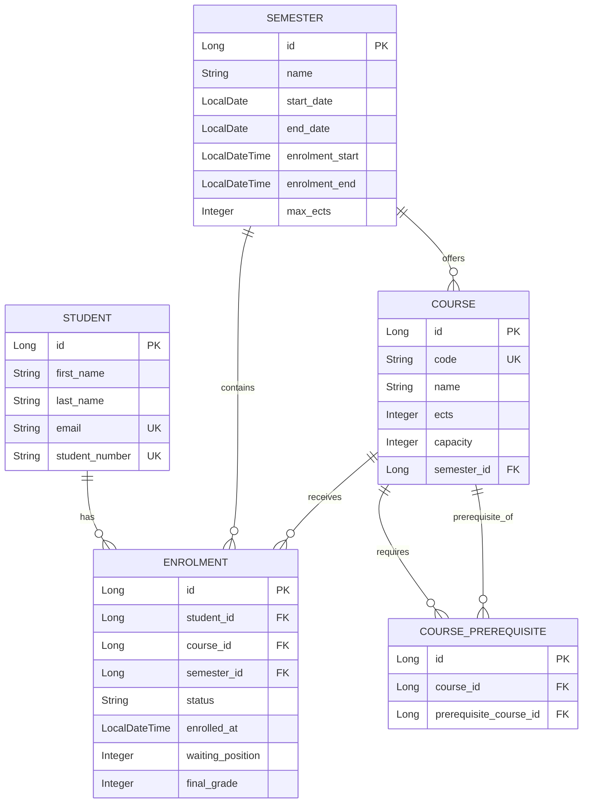

# UniEnroll – Entity Diagram

## Project
P02 – University Course Enrolment

## Description
UniEnroll is a university course enrolment system.
Students can enrol in available courses during an
enrolment window.

The system validates prerequisites, ECTS limits,
course capacity and waiting lists.

## Entity Relationship Diagram

## Relationships

- A student can have multiple enrolments.
- A course can have multiple enrolments.
- Each enrolment belongs to a student and a course.
- A semester contains multiple courses.
- Courses can require other courses as prerequisites.
- Enrolments can have ENROLLED, WAITING or
  WITHDRAWN status.

## Business Rules

1. Students cannot enrol outside the enrolment window.
2. Students cannot exceed the semester ECTS limit.
3. Students must satisfy course prerequisites.
4. Prerequisite relationships must not contain cycles.
5. Course capacity cannot be exceeded.
6. Students may join a waiting list when a course is full.
7. A scheduled job promotes eligible waiting students
   when places become available.
